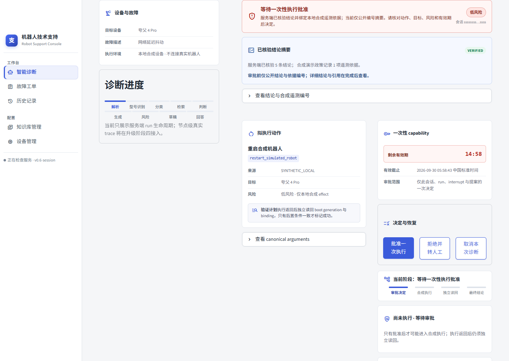
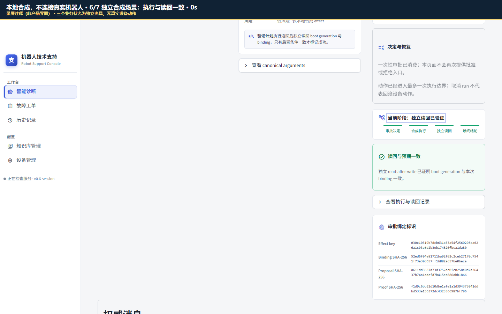
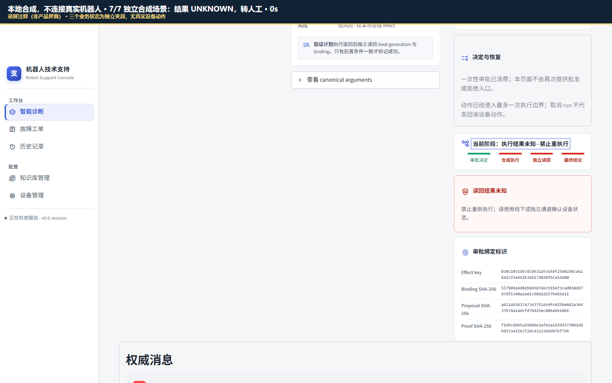
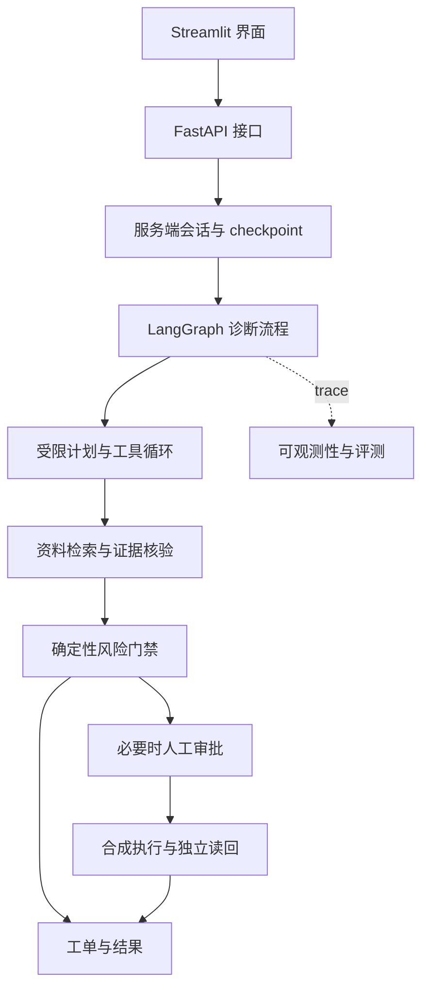

# RobotOps Evidence Agent

**工业机器人故障诊断与安全处置平台：让诊断有证据、操作有边界、失败可追溯。**

基于 FastAPI、Streamlit、LangGraph 与 RAG，实现从故障描述到证据检索、安全门禁、人工审批和执行记录的诊断链路。本仓库提供工程源码、真实界面的合成场景截图，以及无需模型或数据库即可运行的离线演示。

**当前版本：源码展示与合成演示。** 真实模型评测尚未完成，12 项正式指标保持 **Pending**。本项目不连接真实机器人执行控制，不构成设备安全认证。

## 工程亮点

| 能力 | 实现要点 | 源码入口 |
| --- | --- | --- |
| 可信多轮会话 | 服务端维护会话与运行状态，支持幂等请求、checkpoint 恢复 | [diagnostic_sessions.py](app/services/diagnostic_sessions.py) |
| 受限工具循环 | 计划、工具白名单、轮次与调用预算、失败收尾 | [tool_loop.py](app/agent/tool_loop.py) |
| 证据型 RAG | 混合检索、逐结论绑定引用、证据核验 | [hybrid_retriever.py](app/rag/hybrid_retriever.py)、[claim_verification.py](app/agent/claim_verification.py) |
| 确定性安全门禁 | 风险只升不降；证据不足或失败时停止自动处置并转人工 | [safety.py](app/agent/safety.py) |
| 有边界的审批与执行 | 合资格的合成动作绑定会话、提案与有效期；执行后独立读回 | [claim_effect_executor.py](app/services/claim_effect_executor.py) |
| 可观测性与评测 | trace 接缝、评测输入合同与确定性指标公式 | [observability](app/observability/)、[evaluation](app/evaluation/) |

## 界面预览

以下为 **2026-09-30 实际运行的 Streamlit 页面截图**，使用本地合成数据，未连接真实机器人、模型或业务数据库。三张图是独立测试场景，不是同一次审批的连续结果；两张结果图顶部的深色条是录制说明。截图使用的前端源码与本仓库前端一致。

**审批待决：核对证据、动作、风险与有效期。**



<details>
<summary>查看执行已验证与结果未知两个场景</summary>

**合成执行已验证：执行返回与独立读回一致。**



**结果未知：保留 UNKNOWN 状态并转人工复核。**



</details>

页面里的证据 `VERIFIED` 与动作执行验证是两个层次。人工批准也不能绕过高风险、证据不足或未知副作用的门禁。媒体来源与三分钟讲解见 [演示说明](docs/demo.md)。

## 一分钟运行离线演示

准备已有的 **Python 3.12**，在本仓库根目录执行：

```bash
python -S -B -m examples.offline_safety_demo
python -S -B -m unittest discover -s tests -v
```

无需安装第三方依赖、配置 API key、下载模型或启动数据库。`-S` 不加载 site-packages，`-B` 不生成字节码缓存。示例实际调用本仓库的 `safety.py` 与 `execution.py`，输出带 `SYNTHETIC_OFFLINE_DEMO` 标识。

| 合成场景 | 可观察行为 |
| --- | --- |
| 风险等级合并 | 低→高→中后仍保留高风险 |
| 人工接管信号 | 转人工处理 |
| 风险检查或模型失败标记 | 升为高风险并转人工；不实际调用模型 |
| 非法风险值 | 明确拒绝 |
| 轮次预算耗尽 | 前四轮允许，第五轮拒绝；实际工具调用为零 |

随附 **13 个标准库测试**，覆盖正常、非法输入、失败共存和预算边界。这些是确定性合同测试，不是模型准确率。轻量 [GitHub Actions 工作流](.github/workflows/offline-demo.yml) 在公开仓库的普通托管 runner 上自动执行同样两条命令；私有仓库自动跳过，避免使用未知计费额度。运行状态以仓库 Actions 页面为准，不预填通过徽章。

## 系统结构



这是实现结构概览；具体路径由服务端配置与会话版本决定。后端 FastAPI，界面 Streamlit，编排 LangGraph，检索 Chroma，业务库 MySQL，本地会话恢复 SQLite；资料解析使用 PyPDF/python-docx。完整依赖见 [requirements.txt](requirements.txt)。

## 完整服务与验证范围

完整服务的入口是 [Dockerfile](Dockerfile)、[docker-compose.yml](docker-compose.yml) 与 [.env.example](.env.example)。需自行准备获准使用的资料、依赖、模型服务和私有配置；不要提交真实 `.env`。默认端口为 API 8000、前端 8503，绑定本机回环，可通过配置调整。

当前快速开始只保证上述离线演示入口。源工程历史上完成过本地合成 API、临时 SQLite、界面、Docker 健康与可观测接缝等分片验证；本展示目录没有重跑全部历史验收，也没有完成完整服务的全新环境安装或 Docker 重建。Docker 继续使用既有源码白名单，部分宿主评测公式模块不进入镜像。

尚未验证：真实模型诊断效果、真实设备、生产部署、高可用及生产环境的恰好一次执行。没有可发布的真实模型准确率、token 或成本成绩。模型服务及镜像获取可能另需网络或供应商费用，均不属于离线演示命令。

## 来源与后续工作

生产源码来自固定提交 `068501432f15d01e89d9fae144c8c362540a8ceb`，新增展示文档、合成示例、测试和工作流；逐文件来源与摘要见 [CANDIDATE-MANIFEST.json](CANDIDATE-MANIFEST.json)。不包含原 Git 历史、原手册/维修记录、原评测语料、真实配置、模型权重或内部项目记录。

后续工作：完整服务的独立安装复现、真实模型评测、补充失败案例与持续集成覆盖。已实现源码、合成展示和待验证项目分别如实记录。

本仓库暂未提供开源 `LICENSE`，不自动授予 MIT 等使用许可。第三方依赖及品牌名称归各自权利人所有，引用不代表背书。详细范围见 [来源与版本说明](RELEASE_STATUS.md)。
